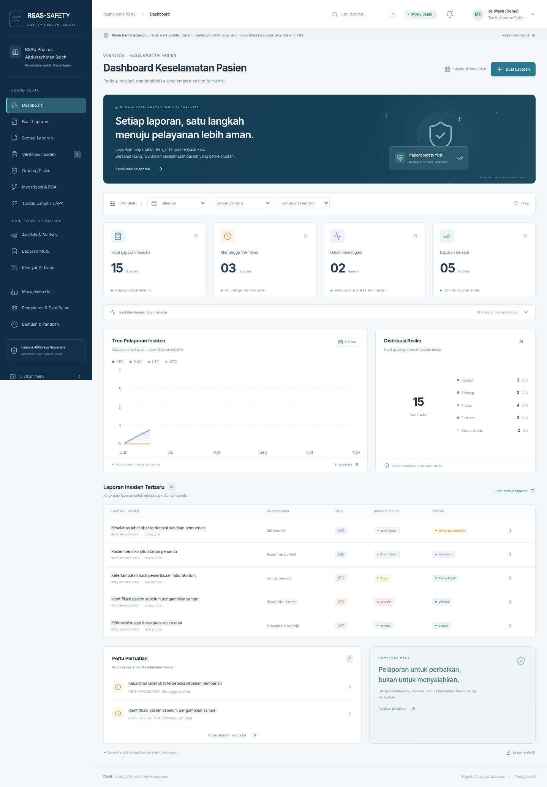

# RSAS-SAFETY

**RSAS Patient Safety Incident Reporting & Risk Management System**
RSAU Prof. dr. Abdulrachman Saleh (RSAS)
_Sagraha Abhipraya Nawasena · Kesehatan untuk Kedaulatan_

Prototipe frontend yang dapat dijalankan, menggunakan **15 insiden sintetis**. Seluruh role, paraf, workflow, timestamp, dan notifikasi adalah simulasi lokal. **Jangan masukkan data pasien nyata, data pribadi, atau password nyata.**

## Menjalankan

Prasyarat: Node.js 22.12+ atau 24 LTS dan npm. Diuji menggunakan Node.js 24.

```sh
npm ci
npm run dev
npm run build
npm run preview
npm run test
```

Jika direktori cache npm bawaan tidak dapat ditulis pada cloud machine:

```sh
npm ci --cache /workspace/.npm-cache
```

Tidak membutuhkan `.env`, secret, API, database, atau layanan eksternal. Font Inter disertakan sebagai aset lokal. Data tetap berada di browser pada origin yang sama.

## Alur demonstrasi

1. Dashboard menampilkan perhitungan dari dataset lokal. Filter waktu, unit, dan jenis memengaruhi statistik serta tabel.
2. Buat Laporan → lengkapi wizard delapan langkah. Draft dapat disimpan sebelum lengkap dan disimpan otomatis setelah perubahan (debounce 1,4 detik).
3. Cari/buka draft pada Semua Laporan → Edit Laporan. Setelah review, konfirmasi data sintetis dan kirim.
4. Pada Detail Laporan, gunakan alur status: dilaporkan → diterima → diverifikasi → investigasi / tindak lanjut → selesai → arsip. Laporan dapat dikembalikan untuk revisi.
5. Gunakan role simulasi Kepala unit / Tim Keselamatan Pasien melalui profil header untuk mengubah klasifikasi/sentinel dan menetapkan grading **manual**.
6. Catat investigasi, Five Whys, fishbone, akar masalah, dan rekomendasi. Tidak ada kesimpulan otomatis.
7. Tambah CAPA; isi realisasi, bukti teks, evaluasi, dan reviewer sebelum status Selesai.
8. Cetak A4 dari detail/review; Laporan Mutu tersedia harian, mingguan, bulanan, triwulanan, dan tahunan.
9. Pengaturan & Data Demo menyediakan backup/restore JSON tervalidasi, pemulihan data rusak, reset 15 contoh, serta penghapusan dengan konfirmasi.

## Cakupan

- Sidebar responsif/collapsible, top navigation, pencarian, role switcher, notifikasi browser, halaman masuk simulasi, bantuan.
- Formulir delapan langkah: data pasien; rincian; pelapor/target; tempat/unit; dampak; tindakan/pencegahan; pengesahan; review.
- Keempat jenis KPC/KNC/KTC/KTD dan penanda sentinel terpisah. Verifikasi sentinel hanya melalui role simulasi petugas berwenang.
- Grading biru/hijau/kuning/merah, identitas dan alasan penilai. **Matriks resmi RSAS belum dikonfigurasi, tidak ada perhitungan skor otomatis.**
- Dashboard, grafik Recharts, evaluasi kejadian berulang, semua KPI dihitung dari dataset tersimpan.
- Ekspor CSV statistik tanpa nama pasien / nomor rekam medis; backup JSON memuat seluruh data **sintetis**.
- Cetak A4, identitas RSAS, watermark DEMO, 14 butir, pengesahan, dan grading. Penomoran halaman memakai CSS paged media di browser yang mendukung (Chromium modern). Aktifkan header/footer browser bila diperlukan pada browser lain.
- Master unit contoh dapat ditambah, diubah, dihapus. Rename memperbarui referensi; unit yang masih dipakai tidak dapat dihapus.

## Katalog referensi indikator mutu

Halaman `/indikator-mutu` menyajikan **34 indikator dari dokumen yang dilampirkan**: 10 prioritas rumah sakit dan 24 prioritas unit. Katalog menyediakan pencarian, filter lingkup/unit/catatan sumber, pagination, profil rinci, ekspor referensi JSON, serta cetak dengan label **BUKAN LAPORAN CAPAIAN**.

Target tertulis dan definisi pengukuran disertai nomor halaman sumber. Tidak ada data capaian, numerator/denominator observasi, atau penetapan target aktif yang dikarang. Katalog bersifat baca saja dan terpisah dari data insiden/demo localStorage maupun master unit demo.

Perbedaan sumber dipertahankan, termasuk target IMP-RS-06 (≥95% / 100%), orientasi staf SDM (95% / 100%), variasi nama HLIU/HILU, dan profil Humas yang belum tersedia. Ambang waktu yang tidak disebutkan dokumen tidak direka. Lihat [pemetaan sumber indikator](docs/quality-indicator-sources.md).

PDF asli dan identitas/nomor personal penandatangan tidak disalin ke repository. Definisi dipakai sebagai referensi, bukan instruksi yang dieksekusi oleh aplikasi atau bukti persetujuan SOP terkini. Grading risiko insiden tetap manual karena lampiran tidak menetapkan matriks grading.

## Struktur

```text
src/
  app/           Router, context, toast, penyimpanan state
  components/    Layout, charts, filters, cetak, editor risiko/RCA/CAPA
  data/          15 insiden sintetis dan contoh investigasi/CAPA
  pages/         Semua halaman aplikasi
  schemas/       Zod, types, validasi input dan backup
  services/      Load/save/export/import localStorage
  styles/        Design system, responsif, dan print CSS
  tests/         Vitest: domain, validasi, storage
  utils/         Workflow, deadline, agregasi, CSV, penomoran
 tests/          Playwright: alur browser dan layout cetak/mobile
```

Namespace penyimpanan: `rsas_safety_v1_settings`, `rsas_safety_v1_incidents`, `rsas_safety_v1_investigations`, `rsas_safety_v1_actions`, `rsas_safety_v1_activity`, dan `rsas_safety_v1_units`. JSON backup memiliki `schemaVersion: 1`. Impor memeriksa schema, ID dan nomor duplikat, kelengkapan laporan terkirim, serta referensi insiden. Data rusak tidak otomatis ditimpa; ekspor mentah dan pemulihan tersedia. Jika penyimpanan penuh/ditolak, perubahan tidak dianggap berhasil. localStorage tidak memberikan transaksi lintas tab atau jaminan backup.

## Pengujian

```sh
npm run test          # Vitest, sekali jalan
npm run build        # TypeScript + Vite production
npm run test:e2e      # Playwright Chromium
```

Konfigurasi E2E menggunakan Chromium sistem pada `/usr/bin/chromium` bila tersedia. Di mesin lain, jalankan `npx playwright install chromium`; konfigurasi otomatis memakai browser Playwright jika Chromium sistem tidak tersedia. Tidak ada backend mock. Setiap test browser memakai localStorage terisolasi. Runner otomatis menjalankan Vite bila belum aktif. Screenshot dan contoh PDF A4 disimpan pada `test-results/` (diabaikan Git).

## Logo resmi

Logo memakai gambar yang disediakan pengguna pada `docs/WhatsApp Image 2026-11-05 at 08.20.42.jpeg`. Aset `public/assets/logo-rsas.png` adalah versi 512×512 tanpa perubahan desain. Logo digunakan di sidebar, halaman masuk, laporan mutu, dan dokumen cetak. Favicon ICO (16/32/48 px), PNG 32 px, serta ikon Apple 180 px dibuat dari gambar yang sama. Tidak ada gambar/logo hasil generasi.

## Vercel

Hubungkan repository di Vercel dengan preset Vite:

- Build command: `npm run build`
- Output directory: `dist`
- Install command: `npm ci`

`vercel.json` menyediakan SPA rewrite untuk refresh URL nested route. Tidak ada serverless function. Deployment belum dilakukan oleh kode ini.

## Acuan dan batasan

Pemetaan 14 butir mengacu pada struktur Formulir 1 Permenkes Nomor 11 Tahun 2017 dan spesifikasi proyek. Lihat [pemetaan formulir](docs/form-mapping.md). Ini **bukan sertifikasi kepatuhan**. Naskah resmi tidak dapat diambil dari lingkungan pengembangan (akses domain sumber dibatasi); Tim Keselamatan Pasien perlu memeriksa pemetaan final, terminologi, SOP, dan matriks sebelum operasional.

Frontend-only tidak menyediakan autentikasi aman, otorisasi server, audit trail permanen, sinkronisasi antarpengguna, atau kerahasiaan/integritas penyimpanan. Role switcher hanya pembatasan UI. Paraf bukan tanda tangan elektronik tersertifikasi. Notifikasi dan tenggat 48 jam memakai jam perangkat; tidak ada email/WhatsApp/SMS/push yang dikirim.

Untuk penggunaan operasional diperlukan backend aman, autentikasi dan RBAC di server, database terlindungi, timestamp server, audit log, backup/pemulihan, kontrol akses ekspor, evaluasi kepatuhan, validasi klinis/SOP, dan tinjauan keamanan institusi.

**RSAS | Quality & Patient Safety Management**

## Pratinjau



[Pratinjau formulir mobile](docs/screenshots/mobile-form.png) · [Katalog indikator mutu](docs/screenshots/quality-catalog.png)
